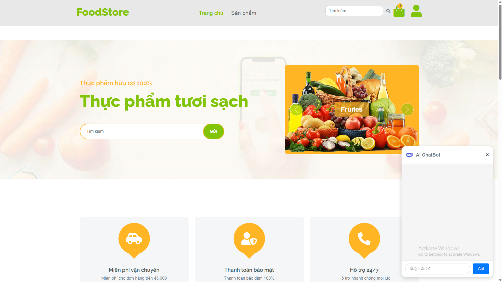
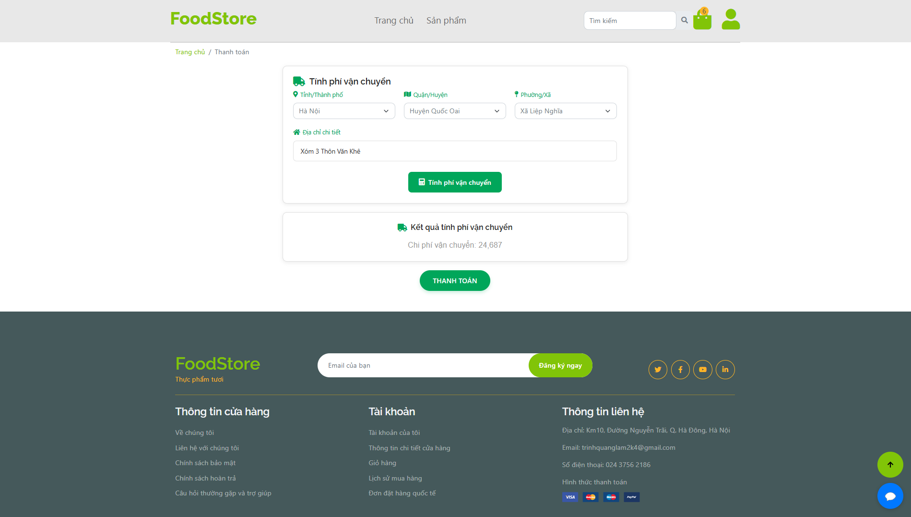
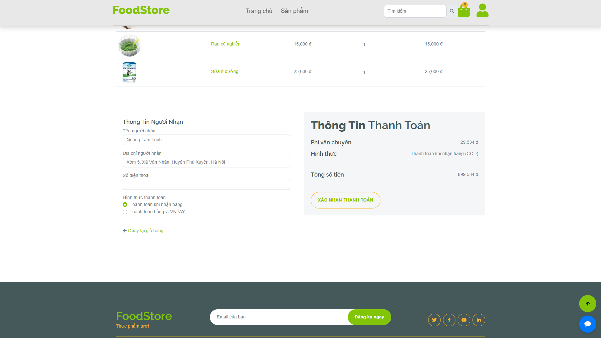
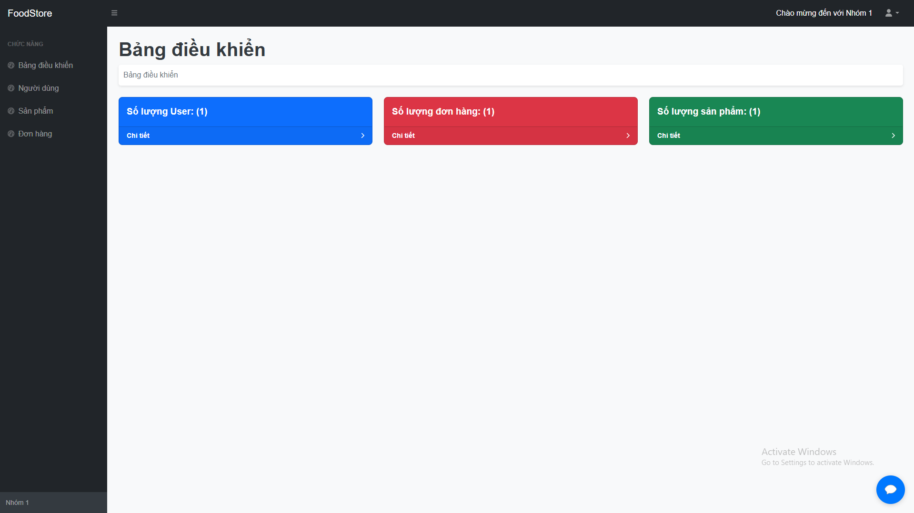
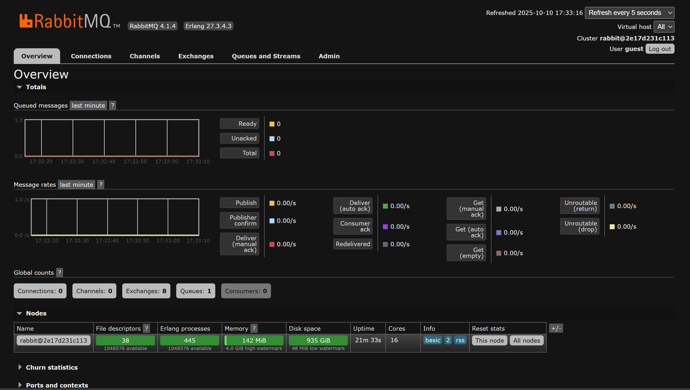
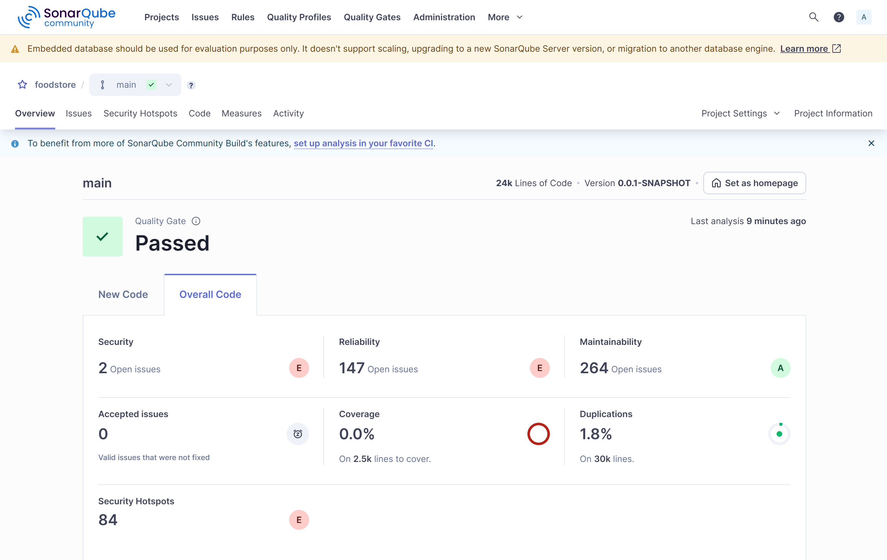

# 🍱 Food Store - Spring Boot Web Application

Dự án website thương mại điện tử chuyên cung cấp thực phẩm tươi sạch, thực phẩm dinh dưỡng và chế độ ăn healthy. Hệ thống được xây dựng trên nền tảng **Spring Boot 3**, tích hợp **Trợ lý ảo AI tư vấn món ăn thông minh (Google Gemini)**, thanh toán trực tuyến **VNPAY**, tính phí vận chuyển tự động **Giao Hàng Nhanh (GHN)** và xử lý bất đồng bộ qua **RabbitMQ**.

---

## 🌟 Demo & Tài khoản thử nghiệm

| Loại tài khoản | Email đăng nhập | Mật khẩu | Quyền hạn |
| :--- | :--- | :--- | :--- |
| **Quản trị viên (Admin)** | `letiendat@vti.com` | `123456` | Toàn quyền quản lý: Sản phẩm, Đơn hàng, Người dùng, Dashboard |
| **Khách hàng (User)** | `user@gmail.com` | `123456` | Mua hàng, Giỏ hàng, Đặt đơn, Lịch sử đơn hàng, Chatbot AI |

---

## 🚀 Tính năng nổi bật

### 🤖 1. Trợ lý AI Tư vấn Thực đơn & Gợi ý Món ăn (Google Gemini AI)
- **Tự động liên kết Database sản phẩm thực tế**: Chatbot tự động nạp danh mục sản phẩm đang mở bán tại Food Store vào ngữ cảnh AI. Khi khách hàng hỏi *"hôm nay ăn gì"*, *"thực đơn giảm cân"*, *"món tăng cơ gymer"*, AI sẽ ưu tiên đề xuất các món ăn nấu từ chính nguyên liệu có sẵn của cửa hàng kèm giá tiền và lợi ích dinh dưỡng.
- **Thanh gợi ý nhanh 1 chạm (Quick Suggestion Chips)**:
  - 🥗 *Thực đơn giảm cân*
  - 💪 *Món tăng cơ gymer*
  - 🍲 *Hôm nay ăn gì?*
  - 🍎 *Trái cây tươi*
  - 👶 *Đồ ăn dặm cho bé*
  - 🥑 *Eat Clean*
- **Chuẩn hóa hiển thị tiếng Việt**: Hỗ trợ đầy đủ dấu, trình bày ngắt đoạn rõ ràng, in đậm giá tiền, icon sinh động và phản hồi siêu tốc (< 1.5s).

### 🛒 2. Chức năng Người dùng (Client)
- Xem danh sách sản phẩm, chi tiết sản phẩm, lọc theo đối tượng và danh mục (Eat Clean, Giảm cân, Tăng cơ, Ăn dặm...).
- Giỏ hàng tiện lợi, cập nhật số lượng, áp mã giảm giá.
- Đặt hàng với 2 phương thức: **COD (Thanh toán khi nhận hàng)** và **Thanh toán trực tuyến qua VNPAY**.
- Tự động tính phí vận chuyển theo khoảng cách thực tế thông qua **Giao Hàng Nhanh API**.
- Đăng nhập linh hoạt: Form truyền thống, OTP SMS và **OAuth2 Login (Google, GitHub)**.
- Quản lý tài khoản cá nhân, xem và theo dõi trạng thái đơn hàng.

### 🛠️ 3. Quản trị hệ thống (Admin Dashboard)
- **Báo cáo & Thống kê**: Biểu đồ doanh thu, số lượng đơn hàng, người dùng mới.
- **Quản lý sản phẩm**: Thêm, sửa, xóa, tải lên hình ảnh sản phẩm, cập nhật tồn kho và phân loại.
- **Quản lý đơn hàng**: Cập nhật trạng thái đơn (Chờ xử lý, Đang giao, Đã giao, Hủy đơn).
- **Quản lý người dùng**: Quản lý danh sách thành viên và phân quyền (ADMIN / USER).

### ⚡ 4. Hạ tầng & Xử lý nền
- **RabbitMQ Message Broker**: Đẩy tác vụ gửi email thông báo xác nhận đơn hàng vào hàng đợi để xử lý bất đồng bộ, tránh nghẽn luồng xử lý web.
- **Bảo mật đa tầng**: Spring Security 6, mã hóa mật khẩu BCrypt, bảo vệ CSRF và quản lý phiên với Spring Session JDBC.

---

## 🛠️ Công nghệ sử dụng

| Phân hệ | Công nghệ | Phiên bản |
| :--- | :--- | :--- |
| **Backend** | Spring Boot, Spring MVC, Spring Data JPA, Spring Security | 3.3.4 (Java 17) |
| **View Engine** | JSP, JSTL, Bootstrap 5, jQuery | - |
| **Database** | MySQL (InnoDB, UTF-8 MB4) | 5.7 / 8.0 |
| **Message Broker** | RabbitMQ (AMQP) & RabbitMQ Management | 4.x |
| **AI Integration** | Google Gemini API (`gemini-3.5-flash-lite`) | v1beta |
| **Payment Gateway** | VNPAY Sandbox | 2.1.0 |
| **Third-party APIs** | Giao Hàng Nhanh (GHN), Twilio OTP, Google/GitHub OAuth2 | - |
| **Build & Deploy** | Apache Maven, Docker, Docker Compose | - |

---

## 📁 Cấu trúc thư mục

```
food-store/
├── src/
│   ├── main/
│   │   ├── java/com/example/food_store/
│   │   │   ├── annotation/          # Custom validation annotations
│   │   │   ├── config/              # Security, RabbitMQ, Cloudinary, MVC configs
│   │   │   ├── constant/            # Enums và Constants
│   │   │   ├── controller/          # REST & MVC Controllers (Admin, Client, GeminiProxy)
│   │   │   ├── domain/              # JPA Entities (Product, Order, User, Role, Cart...)
│   │   │   ├── exception/           # Global & Custom Exception Handlers
│   │   │   ├── messaging/           # RabbitMQ Producer & Consumer (EmailConsumer)
│   │   │   ├── repository/          # Spring Data JPA Repositories
│   │   │   ├── service/             # Business Logic Services & Implementations
│   │   │   ├── utils/               # VNPay, Security, String helpers
│   │   │   └── FoodStoreApplication.java
│   │   ├── resources/
│   │   │   ├── application.properties # Main Spring configuration
│   │   │   └── templates/mail/      # Email HTML templates
│   │   └── webapp/
│   │       ├── resources/           # Static assets: CSS, JS, Images, Vendors
│   │       └── WEB-INF/view/        # JSP Views (client & admin templates)
├── .env                             # Biến môi trường (DB, Mail, OAuth2, Gemini API)
├── docker-compose.yml               # Cấu hình container MySQL, RabbitMQ, Web App
├── Dockerfile                       # Multi-stage Docker build
├── pom.xml                          # Maven dependencies
└── README.md
```

---

## 🚦 Hướng dẫn cài đặt & Khởi chạy

### Yêu cầu tiên quyết
- **Java Development Kit (JDK):** Phiên bản `17` trở lên.
- **Docker & Docker Compose:** Đã cài đặt và đang chạy.
- **Git:** Dùng để clone mã nguồn.

---

### Cách 1: Khởi chạy môi trường với Docker Compose (Nhanh nhất)

#### Bước 1: Khởi động MySQL & RabbitMQ qua Docker
```bash
docker-compose up -d db-mysql rabbitmq
```
- **MySQL Container**: Chạy trên cổng máy chủ `3308` (database: `foodstore`, user: `root`, pass: `123456`).
- **RabbitMQ Container**: Cổng AMQP `5672`, giao diện quản lý tại `http://localhost:15672` (user/pass: `guest`/`guest`).

#### Bước 2: Khởi chạy ứng dụng Spring Boot
```bash
# Trên Windows (PowerShell/CMD):
.\mvnw.cmd spring-boot:run

# Trên Linux/macOS:
./mvnw spring-boot:run
```

#### Bước 3: Truy cập ứng dụng
- Website cửa hàng: **`http://localhost:8080/`**
- Trang đăng nhập: **`http://localhost:8080/login`**
- Quản trị viên: **`http://localhost:8080/admin`**

---

### Cách 2: Chạy toàn bộ hệ thống bằng Docker Compose

```bash
docker-compose up -d --build
```
Hệ thống sẽ tự động đóng gói file WAR của Spring Boot, tạo image và chạy toàn bộ cả 3 dịch vụ (`db-mysql`, `rabbitmq`, `app`).

---

## ⚙️ Cấu hình biến môi trường (`.env`)

Tạo hoặc kiểm tra file `.env` tại thư mục gốc của dự án:

```properties
# Database MySQL
SPRING_DATASOURCE_URL=jdbc:mysql://localhost:3308/foodstore
SPRING_DATASOURCE_USERNAME=root
SPRING_DATASOURCE_PASSWORD=123456
SPRING_JPA_HIBERNATE_DDL_AUTO=update

# Cổng ứng dụng
SERVER_PORT=8080

# RabbitMQ
RABBITMQ_HOST=localhost
RABBITMQ_PORT=5672
RABBITMQ_USERNAME=guest
RABBITMQ_PASSWORD=guest

# Gemini AI (Tư vấn thực đơn & gợi ý món)
API_GEMINI_URL=https://generativelanguage.googleapis.com/v1beta/models/gemini-3.5-flash-lite:generateContent?key=YOUR_GEMINI_API_KEY

# Mail Server
SPRING_MAIL_HOST=smtp.gmail.com
SPRING_MAIL_PORT=587
SPRING_MAIL_USERNAME=your-email@gmail.com
SPRING_MAIL_PASSWORD=your-app-password

# Cổng thanh toán VNPAY (Sandbox)
VNPAY_TMN_CODE=demo_tmn_code
VNPAY_HASH_SECRET=demo_hash_secret
VNPAY_URL=https://sandbox.vnpayment.vn/paymentv2/vpcpay.html
VNPAY_RETURN_URL=http://localhost:8080/afterOrder
```

---

## 📸 Hình ảnh giao diện thực tế

### 🤖 Chatbot AI tư vấn dinh dưỡng & Gợi ý món ăn
Chatbot tự động gợi ý món dựa trên 32 mặt hàng thực phẩm tươi sạch trong cơ sở dữ liệu:
- Nút bấm nhanh: Giảm cân, Tăng cơ, Hôm nay ăn gì, Trái cây tươi, Ăn dặm cho bé,...
- Cung cấp tên món, mức giá tại quán, công dụng dinh dưỡng và cách kết hợp nguyên liệu.

### 🌐 Giao diện Khách hàng & Quản trị

| Trang chủ & Danh mục món | Giỏ hàng & Tính cước GHN |
| :---: | :---: |
|  |  |

| Cổng thanh toán VNPAY | Dashboard Quản trị ADMIN |
| :---: | :---: |
|  |  |

| Quản lý hàng đợi RabbitMQ | Báo cáo chất lượng SonarQube |
| :---: | :---: |
|  |  |

---

## 📞 Hỗ trợ & Đóng góp
- **Nhóm phát triển:** Food Store Development Team
- **Liên hệ hỗ trợ:** `tdglobal8386@gmail.com`
